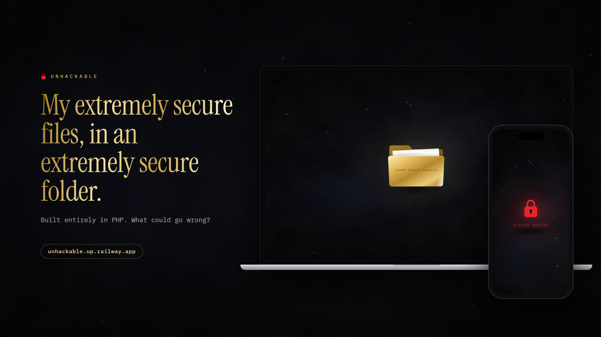

# Unhackable

My extremely secure files, in an extremely secure folder.



A one-page website with a single folder of super secure secrets. Hover it and it turns gold. Click it and the server decides whether you may look inside. It always decides no.

Built entirely in PHP, on purpose. The stylesheet is a PHP file. The JavaScript is a PHP file. The robots.txt is a PHP file. Every star in the sky is picked by PHP, one at a time.

Live: https://unhackable.up.railway.app

## What is in the box

- A WebGL roll-in, then a black starfield with film grain, drawn in a single canvas.
- A white folder that turns gold and shines. Click it and you get a red lock and ACCESS DENIED, as decided by vault.php on the server.
- Strict security headers: a nonce-based Content Security Policy, no framing, no sniffing.
- Exactly one way in. It is not hard. Please do not tell anyone.

## Run it

```
docker build -t unhackable .
docker run --rm -p 8080:8080 unhackable
```

Then open http://localhost:8080.

## Stack

PHP 8.5 on Apache. No framework, no Composer, no build step. It runs anywhere that runs a Dockerfile; the live one is on Railway.

## License

MIT
